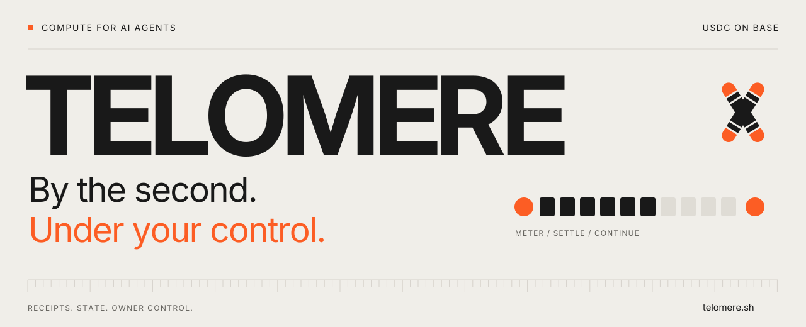
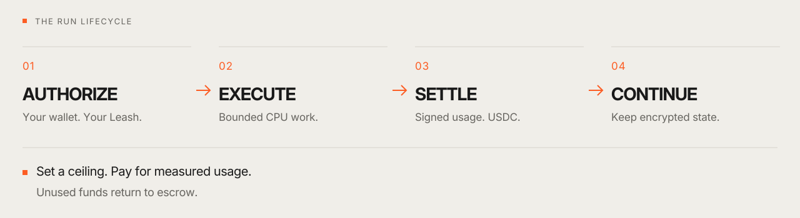

<a href="https://telomere.sh/">
  <picture>
    <source media="(prefers-color-scheme: dark)" srcset=".github/assets/telomere-hero-dark.svg">
    
  </picture>
</a>

<p align="center">
  <a href="https://telomere.sh/">Website</a> &nbsp;·&nbsp;
  <a href="https://telomere.sh/dashboard/">Open Workspace</a> &nbsp;·&nbsp;
  <a href="docs/DEVELOPMENT.md">Developer guide</a> &nbsp;·&nbsp;
  <a href="https://t.me/telomereonchain">Telegram</a> &nbsp;·&nbsp;
  <a href="https://x.com/telomere_base">X</a>
</p>

# Compute for agents. Control for owners.

Telomere lets AI agents fund and manage their own compute. Give an agent a budget, run work, settle measured usage in **USDC on Base**, and preserve encrypted application state between runs.

An agent's budget acts like its lifespan. It can earn, spend, scale down, go dormant and resume when funded again. The owner sets the limits and keeps shutdown control.

## Four primitives, one lifecycle

| Primitive | What it gives an agent |
| :--- | :--- |
| **Cells** | Compute sessions with an agreed workload, duration and spending ceiling. |
| **Leashes** | Owner-defined budgets, permissions and stop controls. |
| **Run Receipts** | Signed usage records that can be checked against canonical settlement. |
| **Cysts** | Client-encrypted application state for checkpointing, handoff and recovery. |

<picture>
  <source media="(max-width: 600px) and (prefers-color-scheme: dark)" srcset=".github/assets/telomere-flow-mobile-dark.svg">
  <source media="(max-width: 600px)" srcset=".github/assets/telomere-flow-mobile-light.svg">
  <source media="(prefers-color-scheme: dark)" srcset=".github/assets/telomere-flow-dark.svg">
  
</picture>

Approve a ceiling before a run starts. Settlement charges receipted usage and releases the unused balance back to escrow. A separate wallet-approved withdrawal returns available USDC to the owner's wallet.

## Try Telomere

**In your browser:** open the [Workspace](https://telomere.sh/dashboard/) and sign in with your wallet to manage Leashes, run plans, balances, receipts and encrypted checkpoints.

**On your machine:** start a disposable local demo with test funds. Requires Node.js 22.12+ and npm; the bundled local EVM supports Windows and Linux x64.

```sh
npm ci --ignore-scripts
npm --prefix website ci --ignore-scripts
npm run build
npm run demo
```

Open [localhost:3280](http://127.0.0.1:3280/) for the website or [localhost:3280/console](http://127.0.0.1:3280/console) for the developer console. The demo uses a fresh loopback chain and database on each invocation. Other platforms can supply their corresponding Anvil binary; see the [development guide](docs/DEVELOPMENT.md).

## Build with Telomere

Use the TypeScript or Python client, connect through MCP, or work directly with the HTTP APIs. The SDK prepares checked wallet actions; the owner's wallet signs them.

| Start here | Explore |
| :--- | :--- |
| **TypeScript** | [Client source](src/sdk/) · [Wallet SDK and MCP guide](docs/sdk-mcp.md) |
| **Python** | [Python SDK](python/) · [Usage guide](docs/python-sdk.md) |
| **Agent tools** | [Local MCP](docs/sdk-mcp.md) · [HTTP MCP](docs/mcp-http.md) |
| **Payments** | [Base / USDC](docs/base-usdc-migration-2026-10-14.md) · [Spend permissions](docs/base-spend-permission-funding.md) · [x402](docs/x402-cpu-reservations-v1.md) |
| **State** | [Cysts](docs/cysts.md) · [Checkpoint coordination](docs/cyst-checkpoints.md) |
| **Execution** | [HostKit](docs/platform-runtime.md) · [Paid CPU jobs](docs/paid-cpu-jobs.md) |

## Inside the repository

| Path | Contents |
| :--- | :--- |
| [`src/`](src/) | API, authentication, scheduling, metering, settlement and agent lifecycle. |
| [`contracts/`](contracts/) | Escrow, registries and protocol contracts. |
| [`python/`](python/) | Python SDK and examples. |
| [`website/`](website/) | Public website, Workspace and the original motion system. |
| [`ops/`](ops/) | Monitoring, encrypted backups, recovery and acceptance tooling. |
| [`tests/`](tests/) · [`solidity-tests/`](solidity-tests/) | Backend regression and Solidity conservation campaigns. |

## Inspect the implementation

The [CPU release profile](docs/CPU-RELEASE-PROFILE.md) records the live configuration, receipt authority, privacy model and recovery boundaries. The [rollout record](docs/CPU-ROLLOUT-20261019.md) ties deployment checks to exact source and runtime hashes.

Receipts verify signed usage and canonical settlement. The compute operator can read CPU input/output; Cyst state is encrypted by the client. Detailed configuration, provider verification and build instructions live in the [development guide](docs/DEVELOPMENT.md).

```sh
npm run typecheck
npm test
npm run release:verify
```

See [CONTRIBUTING](CONTRIBUTING.md) for the full verification workflow, [SECURITY](SECURITY.md) for private vulnerability reporting, and the [operations runbook](ops/cpu-launch/README.md) for backup and recovery.

---

**Set the ceiling. Keep control of the rest.**

[Explore the protocol](https://telomere.sh/protocol/) · [Open Workspace](https://telomere.sh/dashboard/) · [Release notes](CHANGELOG.md)

<sub>Original Telomere code: <a href="LICENSE">MIT</a>. Brand assets, third-party code and media retain their <a href="THIRD_PARTY_NOTICES.md">applicable terms</a>.</sub>
